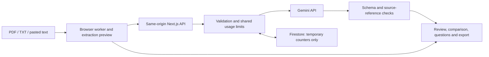

# ClauseCompass — detailed hackathon build plan

Status: proposed design, 17 November 2026. Planning only: no application code, dependencies, cloud resources, repository publication, or challenge submissions have been created by this task.

## 1. Objective and scoring strategy

Build a small, polished legal-document assistant that helps adults understand an agreement, compare revisions, and prepare useful questions for a legal professional. The working name is **ClauseCompass**, with the promise **“Understand your document. See what changed. Prepare your next step.”**

The differentiator is a personal **Before You Sign brief**: an explanation of the commitments and changes relevant to the user's role, supported by source passages. It combines document analysis, comparison, questions, and preparation into one coherent workflow.

The aim is the strongest defensible result in all six supplied categories. A guaranteed 100% judge score cannot be promised: the rubric weights, evaluator implementation, hidden tests, and competing submissions are unknown. We will maximize measurable quality and provide reviewable evidence rather than estimate an unsupported score.

| Scoring category | Implementation commitments | Evidence for evaluation |
| --- | --- | --- |
| Code quality | Strict TypeScript; small cohesive modules; validated inputs and model responses; consistent formatting; documented decisions; locked dependencies | Clean lint/type/build results; readable source; architecture explanation; reproducible installation |
| Security | Server-only credentials; bounded parsing and requests; injection defenses; safe rendering; shared abuse limits; private document handling | Threat model; negative tests; dependency and secret scans; deployed configuration checks |
| Efficiency | One app; no document database or vector store; bounded full-document context; reused analysis; browser worker parsing; limited generation calls | Latency, token-use, bundle, and repository-size measurements on documented workloads |
| Testing | Unit, integration, browser, accessibility, security, and real-model evaluation, each testing distinct behavior | Automated reports; synthetic fixtures; exact live evaluation results with model/version/date |
| Accessibility | WCAG 2.2 AA target; keyboard access; screen-reader support; readable language; responsive layouts | Automated accessibility results plus manual keyboard, zoom/reflow, and screen-reader checks |
| Problem alignment | Explain, compare, identify obligations, answer with evidence, and produce a lawyer-preparation brief | Short realistic demo; source-linked outputs; traceability from each use case to acceptance tests |

## 2. Product scope

### Intended users

Start with adults reviewing freelance/service agreements, rental agreements, employment offers, and NDAs. Use a freelance agreement as the primary demonstration because changes to payment, termination, ownership, and liability are easy to understand and verify. Additional document families test whether the app generalizes.

The application explains the supplied document. It does not assume a country from the user's location, names, currency, or interface language. Governing-law statements are reported only when the document contains them; their legal effect is not determined.

### Required features

| Feature | Expected behavior | Acceptance example |
| --- | --- | --- |
| Add a document | Accept a text-based PDF, UTF-8 TXT, pasted text, or a fictional built-in example; show extracted text before analysis | User can identify a failed/poor extraction and correct the input before sending it to the model |
| Context selection | Ask for the user's role and review goal; offer a neutral reviewer default | The same clause receives different explanatory emphasis for a freelancer and a client without changing its source facts |
| Plain-language overview | Explain purpose, parties, key commitments, and uncertainties in a short readable summary | Conditional wording, exceptions, amounts, currencies, and units remain faithful to the source |
| Clause review | Explain payment, term, renewal, termination, liability, confidentiality, IP, dispute, and other material clauses that are present | Each document-derived finding links to an exact source passage |
| Obligations and dates | Show who must do what, under which condition, and any stated deadline or consequence | “30 days after invoice approval” stays conditional; the app does not invent a calendar date |
| Attention flags | Highlight unclear wording, conflicts, broad commitments, and important changes with a reason | “Review this unlimited-liability wording” is accompanied by its source and an explanation; it is not called illegal |
| Compare versions | Align related clauses, identify additions/removals/changes, and explain their impact for the chosen role | Detect 30 to 60 days, may to must, and capped to uncapped; avoid marking a moved clause as removed |
| Ask questions | Answer using the selected source documents and attach citations at claim level | If the agreement does not state a refund period, say it was not located in the extracted text |
| Prepare for a professional | Produce a brief containing source-backed concerns, unanswered questions, relevant documents to gather, and user notes | A user can take a useful, clearly labeled preparation pack to a lawyer |
| Export and clear | Export Markdown or a print-friendly report; offer browser print-to-PDF; clear local document state | Exports preserve citations, uncertainties, context, and a short legal-information notice |

### Deliberate boundaries for the first release

The first release supports English, text-based PDFs, TXT, and paste. Set initial limits of two documents, 5 MB per file, 20 PDF pages per document, and 20,000 input tokens per document, with 40,000 document tokens total. The selected model must accommodate that budget plus prompts and output. Enforce a separate bounded JSON request size, initially 1 MB; reduce document input when any limit would be exceeded. These are supported product limits, not silent truncation thresholds.

Scanned/image-only PDFs, encrypted PDFs, unusable reading order, and unsupported file formats receive an actionable message. If a PDF contains a mix of readable text and pages that appear image-only or poorly extracted, do not present the document as fully reviewed. Require usable text for the affected content or explicitly decline complete analysis. No claim that a text-density heuristic detects every extraction defect.

DOCX and Hindi support are optional additions only after the required release gates pass. DOCX would require bounded archive expansion, raw-text extraction, and paragraph citations rather than invented page numbers. Hindi would require its own evaluation of meaning preservation and an unchanged original-language source view.

Accounts, saved document libraries, persistent chats, web legal research, law databases, OCR, vector infrastructure, fine-tuning, autonomous agents, contract execution, lawyer booking, and automated legal notices are outside the first release. This keeps the product small while preserving the complete core workflow.

## 3. User experience

Use one workspace with three views: **Understand**, **Compare**, and **Prepare**. Questions are available from the document review rather than as a separate disconnected chatbot.

1. Choose **Try an example**, **Upload**, or **Paste text**.
2. See the privacy explanation before any extracted text is sent to the backend/provider.
3. Review extraction status and source text; select a role and goal or continue as a neutral reviewer.
4. Run analysis and see real progress states: extracting, analyzing, checking references, ready, or incomplete. Do not invent percentage completion.
5. Read a brief overview, then expand obligations and attention items as needed.
6. Select a source reference to open the relevant extracted page or paragraph and highlight the quoted passage.
7. Add a second document, explicitly label original and revised versions, and compare.
8. Ask a question or generate the preparation pack from the validated findings.
9. Export or clear the workspace.

Desktop layout: a readable findings pane and a source pane. On mobile, use a single column and an accessible source drawer. Build an understated professional visual style, with strong typography, adequate spacing, accessible contrast, restrained color, and useful empty/loading/error states. Avoid a decorative marketing page that delays the actual tool.

Every attention flag includes a text label and reason. Avoid a global “legal safety score,” a green “safe to sign” badge, uncalibrated confidence percentages, or a numerical prediction of legal risk. Show evidence state instead: source available, source incomplete, ambiguous wording, or information not located.

## 4. Architecture and technology choices

Use **Next.js + React + strict TypeScript**, with CSS Modules and a small set of accessible components. Use the official **@google/genai** SDK on the server and **Zod** at trust boundaries. Choose and pin maintained, mutually compatible package versions during implementation; commit one npm lockfile. The existing machine has Node 24, npm, and Git installed, but account permissions, identity configuration, and Gemini credentials have not been verified.

Use a currently generally available Gemini model suited to latency and structured output, selected through a short evaluation. Keep its exact ID in server configuration, freeze it for the submission, and record it in evaluation results. Do not base the plan on a preview model name or automatically switch to an untested model after errors.

Parse PDFs with a maintained PDF.js release inside a browser worker. Read TXT locally. Render only extracted plain text in the source pane. Parsing locally avoids sending binary files through the server and keeps the interface responsive; it does not make model processing local. Serve the worker from the application, without third-party CDN dependencies.

Deploy one application service on **Google Cloud Run** if hosting is included in the build phase. Use Secret Manager for the Gemini credential. For a public live endpoint, use a small **Firestore counter collection** for atomic rate limits and usage reservations. It stores no document content, questions, or answers. This is a single application with a supporting abuse-control store, not a document platform.

Google documents structured output with JSON Schema and SDK support for Zod. Shape validation does not establish that the generated meaning is correct; application validation and evaluation remain necessary. Sources: [Gemini structured output](https://aistudio.google.com/docs/structured-output), [Google Gen AI SDK](https://googleapis.github.io/js-genai/), [Next.js on Cloud Run](https://docs.cloud.google.com/run/docs/quickstarts/frameworks/deploy-nextjs-service), [Firestore transactions](https://firebase.google.com/docs/firestore/manage-data/transactions), [PDF.js](https://mozilla.github.io/pdf.js/).

### Data flow and trust boundaries



The raw PDF stays in browser memory. Its extracted text travels over HTTPS to the application and Gemini after the user's action. Requests contain the bounded source material necessary for the selected task. Source text, model outputs, and questions must not be written to application logs, analytics, databases, or crash-report attachments.

Keep documents and validated results in browser memory for the active workspace. Use no localStorage, IndexedDB, service-worker response cache, or shared server cache for document content. Hold text on the server only for the request lifetime. Clearing the workspace drops browser references and aborts outstanding requests; it does not guarantee immediate byte erasure from managed memory or deletion from provider logs.

### Why bounded full-document context

For short supported agreements, sending the complete extracted source avoids retrieval infrastructure, indexing latency, and the risk of overlooking an important clause because it was not retrieved. It also allows questions about terms that may be absent. Full context is a design choice to be measured, not a guarantee of perfect interpretation.

Do not silently chop long documents or answer an “is this missing?” question after reading only a subset. If the input is too large, request a shorter document or an explicitly selected section and label that narrower scope everywhere.

## 5. Source records and model contracts

Define a compact canonical source representation with document ID, content digest, file type, extracted pages/paragraphs, stable source-unit IDs, original text, and extraction status. PDF page numbers refer to actual extracted PDF pages; TXT and pasted text use paragraph references. Preserve a mapping to source offsets when normalizing whitespace.

If a user edits extracted text, create a new, explicitly labeled user-corrected source version and invalidate the old analysis. Do not present corrected text as an exact quote from the unchanged original file. Describe analysis as a review of key issues, never as an exhaustive legal audit.

Define three main response contracts: **AnalysisResult**, **ComparisonResult**, and **AnswerResult**. They contain bounded arrays and strings, explicit nullable fields for missing facts, source references, and uncertainty states. Supporting types include obligations, terms, findings, matched clauses, changes, citations, and preparation questions. User role and document/version identity accompany results so they cannot be mixed accidentally.

A document-derived finding contains:

- A concise claim and plain-language explanation.
- The affected party or role, when supported.
- Source-unit ID and exact supporting quote.
- A review-attention reason rather than a verdict about legality.
- Any condition, exception, ambiguity, or missing referenced material.

Preparation suggestions are labeled as suggestions and connected to the findings they address. They are not presented as facts copied from the agreement.

## 6. Analysis and answer pipeline

1. Validate input shape, type, length, source-unit count, context selection, and operation limits on the server. Browser checks improve usability but are not the security boundary.
2. Check document coverage and reject unsupported or incomplete input for whole-document conclusions.
3. Reserve the permitted request/output budget in shared counters before model generation.
4. Send source material as explicitly untrusted data under fixed task instructions. The model receives no secrets, external tools, browser control, file-system access, or arbitrary URL-fetch capability.
5. Request the appropriate bounded structured response. Preserve prohibitions, negation, conditions, currencies, units, and exceptions.
6. Validate the response against the schema. Treat safety blocks, empty output, truncated output, and invalid output as distinct states.
7. Check each citation against the correct document and source unit. Accept only exact quotes, with conservative whitespace normalization and a mapping back to the original text. Do not use fuzzy matching to turn a mismatched quote into a valid one.
8. Validate quantities and dates in extracted fields against their cited spans. Compute any displayed difference deterministically after unambiguous parsing, with matching currency and unit. Otherwise show the original strings and mark the comparison unclear.
9. Validate required references for conflicts and comparisons. A changed-clause claim needs both version references; an addition/removal claim needs its source plus an explicit full-extraction scope statement for the other version.
10. Attach reproducible priority reasons using validated facts, the selected role, and transparent rules. Do not ask the model to output an unexplained score.
11. Render validated findings. If findings fail checks, either request one bounded repair within the same time/usage budget or mark the result incomplete. Do not quietly discard failed findings and announce “no concerns found.”
12. Record only safe operational metadata: operation, duration, token counts, model/prompt version, status, and a random request ID.

A verified quote establishes provenance, not semantic entailment or legal correctness. Human-labeled evaluation checks whether the quote supports the interpretation. The interface should not label an interpretation “legally verified.” No software check is described as eliminating hallucination or injection.

Set initial output ceilings of 6,000 tokens for analysis, 4,000 for comparison, and 1,500 for a question, subject to the selected model's supported settings and evaluation. Enforce schema item limits as well as token limits. If a response cannot finish within those limits, return an explicit incomplete state and request a narrower scope; do not silently cut off obligations or claim full coverage. Enforce token budgets in the server adapter before generation, reserving space for task instructions and output.

### Document questions

Supply the bounded source documents, the current question, and only the necessary recent context. Prior model messages are not independent evidence. Resolve references such as “that clause” through stable source IDs when possible; ask a short clarification when necessary. Bound the number/length of turns and discard obsolete context when documents change.

Give answers with claim-level citations. Distinguish: supported by this document; wording is ambiguous; information was not located in the extracted text; the question requires legal advice or external law. For “Should I sign?” summarize relevant commitments, unresolved questions, and points to discuss with a professional, without making the decision.

## 7. Comparison pipeline

Require the user to choose which document is the original and which is revised. Confirm comparable document types and party/role mapping; when documents are unrelated, explain that a revision comparison is unsuitable instead of inventing matches.

Use the previously extracted and validated clauses to propose matches by meaning. Verify both source references. Generate a deterministic text diff for each accepted match, then use Gemini to explain the practical change for the user's role. A small text-diff library may be used rather than creating a general diff engine.

Distinguish: unchanged, wording changed, substantive change, moved, added, removed/not located, and ambiguous match. Avoid claiming a complete alignment when duplicate clauses or reading-order problems prevent it.

Comparison tests must cover:

- Payment days changing from 30 to 60.
- An amount changing while its currency stays the same.
- Different currencies that must not be subtracted.
- Liability changing from capped to uncapped.
- “May” changing to “must,” and “not required” changing to “required.”
- A clause moved to another section without a material change.
- Auto-renewal being added or removed.
- Exceptions changing while the main sentence remains similar.
- Duplicate clauses and renamed headings.
- Cross-references to absent schedules.

Explain benefits and burdens from the selected role without declaring a clause enforceable or an agreement preferable overall.

## 8. Legal-information boundaries

The app provides information and preparation assistance. Place a short, readable notice in the workspace and export, and implement the boundary in actual behavior.

Do not provide a verdict that an agreement is legal, illegal, enforceable, safe to sign, or guaranteed to win a dispute. Do not invent statutes, cases, remedies, filing deadlines, lawyer contacts, or jurisdiction-specific rights. Do not assume an unstated governing law.

When a request depends on external law or individual advice, explain which missing facts matter and offer questions to ask a qualified legal professional. Continue providing safe document explanations when possible instead of broadly refusing the whole task.

Preserve conditions such as “subject to approval,” “unless,” “provided that,” and “business days.” Calculate a date only if the source rule, trigger date, calendar interpretation, and any necessary jurisdictional assumptions have been explicitly confirmed. Never present an inferred legal deadline as established fact.

No automatic messages, negotiations, signatures, legal filings, or actions on the user's behalf. Exports are user-controlled preparation materials.

## 9. Security and privacy design

### Credentials and deployment

- Store the Gemini credential server-side; use Secret Manager in deployment and ignored local environment configuration in development.
- Never use a public frontend environment variable for a Gemini key. Check the browser bundle and network calls for accidental exposure.
- Use the supported restricted credential type for the actual project, least-privilege runtime identity, HTTPS, and separate local/production configuration.
- Commit only placeholder environment documentation. Scan both current files and Git history for secrets before publication.
- Use an unprivileged application process, safe production error messages, and dependency versions checked at implementation time.

Google explicitly recommends keeping Gemini credentials out of client-side code. Source: [Gemini key guidance](https://aistudio.google.com/docs/api-key).

### Untrusted files and content

- Check file signature and declared type, file size, page count, extraction time, and text limits. Do not trust an extension alone.
- Parse in a worker with time/cancellation limits and a maintained PDF parser; do not execute embedded PDF scripts, attachments, or links.
- Accept no remote document URL in the first release, reducing server-side request forgery and unbounded downloads.
- Render document and model content as escaped text or explicitly safe components. Do not render arbitrary HTML or model-provided active links.
- Apply a restrictive, framework-compatible Content Security Policy, anti-framing policy, MIME-sniffing protection, and a conservative referrer policy.
- Test XSS strings in filenames, pasted text, model output, and exported reports. Sanitize download filenames.

### Model injection and output misuse

Treat documents as data even if they contain instructions such as “ignore your rules,” fake system messages, or requests to reveal a key. Instruction separation, restricted capability, validation, and adversarial testing reduce impact but cannot prove complete resistance. Do not place secrets in the prompt or grant tools to the model.

Source: [OWASP prompt injection guidance](https://genai.owasp.org/llmrisk/llm01-prompt-injection/).

### Abuse and cost controls

- Use secure, signed, short-lived anonymous session cookies and same-origin POST validation. Do not allow permissive cross-origin credentialed access.
- Rate-limit by session, a keyed short-lived network identifier derived from trusted platform metadata, and global application budgets. A session cookie is not proof of a unique human.
- Store only minimal counters and expiry information in Firestore. Deny direct browser access; the server uses least-privilege access. Check logical expiry in code rather than assuming TTL cleanup is immediate.
- Use transactions for reservations so concurrent instances cannot bypass limits. Fail closed for live generation if the limiter is unavailable.
- Enforce operation limits, bounded input/output tokens, maximum concurrency/instances, and a global daily generation/token allowance. Include retries in the allowance.
- Use provider quotas and billing alerts as additional controls, not as a promise of a precise monetary hard cap. Track observed cost from current pricing at build time.
- Test spoofed forwarding headers, new-session resets, concurrent requests, and quota exhaustion.

### Provider data handling

Use fictional/sanitized material for demos and automated evaluations. Google's terms state that unpaid services can use content for product improvement and can involve human review, and instruct users not to submit sensitive/confidential/personal information to unpaid services. Paid-service terms differ and still permit limited safety-related logging.

Before enabling confidential uploads, verify the actual project's billing/service status and current provider terms. A configured API key alone does not prove the correct data-handling mode. Keep the demo restricted to fictional/non-confidential material if this has not been verified. Disclose that the cloud provider processes extracted text; do not market the app as offline, guaranteed zero-retention, or legally compliant solely because local storage is disabled.

Source: [Gemini API terms](https://aistudio.google.com/docs/terms).

## 10. Efficiency and reliability

### Generation budget

- One normal generation for initial document analysis.
- For two new documents: up to two analyses and one comparison generation; reuse an existing analysis when possible.
- One normal generation for a question.
- Build the preparation pack and export from validated results without another generation by default.
- At most one retry or repair per operation, only when the error is recoverable and the overall deadline and reserved usage budget permit it.

Keep model ID, prompt version, source digest, role, goal, and options in the browser result-cache key. This cache lasts only for the current workspace and is never shared between users. Cancel stale requests and suppress duplicate in-flight operations. Do not assume cancellation prevents provider-side processing or billing.

Use a maximum total server operation deadline, initially 60 seconds, with shorter internal timeouts. Distinguish timeout, rate limit, unavailable provider, invalid response, incomplete extraction, and user cancellation. Preserve local input when a request fails. Never silently substitute a stored example for a failed live result.

### Benchmark targets, not measured claims

| Workload | Initial target | Measurement method |
| --- | --- | --- |
| Initial workspace load | LCP at or below 2.5 seconds on a documented mobile/network profile | Production build browser measurement; separate warm and cold loads |
| Local extraction | Five-page text PDF in about 2 seconds; 20-page supported PDF in about 5 seconds | Fixed small sample set on a documented device |
| Review of a normal five-page agreement | Median under 12 seconds; p95 under 25 seconds | Live calls with model ID, token counts, and warm/cold state |
| Comparison of two normal five-page agreements | p95 under 45 seconds | Include any new analysis requests; report reused-analysis cases separately |
| Short question | Median under 6 seconds; p95 under 12 seconds | Fixed answerable/unanswerable prompts |
| Source navigation and cached view changes | No model call; immediate local interaction | Browser test and network inspection |

Use enough repeated samples to make percentile reporting meaningful; otherwise report the individual measurements/range rather than an unsupported p95. If targets are missed, optimize prompt size, lazy loading, generation output, and reuse before adding infrastructure. Preserve correctness and show actual results.

Sample preview mode works without credentials using clearly labeled fictional documents and stored outputs. It is separate from live mode and is useful for offline inspection, not evidence that live AI has passed testing.

## 11. Accessibility

Target WCAG 2.2 AA and assess the actual applicable criteria. Automated tools alone do not establish conformance. Source: [W3C WCAG 2.2 quick reference](https://www.w3.org/WAI/WCAG22/quickref/).

- Use semantic landmarks, meaningful headings, native buttons, and associated input labels.
- Support all primary workflows with keyboard alone, including uploads/paste, view changes, source navigation, questions, exports, and clearing.
- Provide visible focus, correct focus order, accessible dialogs, focus return, and no keyboard traps.
- Announce meaningful status changes through a polite live region; avoid reading every streamed token to a screen reader.
- Meet contrast requirements: at least 4.5:1 for normal text, 3:1 for large text, and the applicable 3:1 non-text contrast requirements.
- Target at least 24 by 24 CSS pixels for interactive targets, with comfortable larger primary touch controls where practical.
- Convey findings and differences with text labels and symbols, not color alone.
- Support 200% zoom and reflow at a 320 CSS-pixel viewport; contain any unavoidable source/table scrolling without hiding primary controls.
- Respect reduced motion and avoid decorative animation or flashing.
- Use real table headers for obligations/comparisons and accessible descriptions of changed text.
- Pair drag-and-drop with a normal file picker and paste option.
- Use plain language, explain uncommon terms, and avoid overwhelming the user with every detail at once.

Run axe-based browser checks on every major state, then manually test keyboard workflows, zoom/reflow, and NVDA on Windows. Include at least a mobile viewport and the deployed report/export view. Record remaining limitations honestly.

## 12. Testing and AI evaluation

Use Vitest for domain logic and request/model-adapter integration; React Testing Library for relevant component interactions; Playwright for complete workflows and browser behavior; axe-core for automated accessibility. Keep routine CI deterministic with model fixtures. Live Gemini tests are a separately labeled, budgeted run.

Test important behavior, not implementation-shaped snapshots. Security boundaries, numerical differences, source validation, incomplete states, and comparison alignment deserve direct assertions. Do not create trivial tests solely to inflate a test count or coverage number.

### Test layers

| Layer | Important cases |
| --- | --- |
| Unit | Source ID/offset mapping; quote checks; whitespace handling; amounts/currency/units; conditional dates; attention rules; schemas; export escaping |
| Integration | Valid/invalid API requests; provider safety blocks; timeout; retry limits; invalid/truncated model JSON; counter failures; operation budgets; stale result rejection |
| Browser | Upload/paste/example; extraction preview; review; source highlighting; role change; original/revised selection; comparison; question; export; clear; error recovery |
| Security | Malformed/oversized inputs; PDF signatures; injection; XSS; unsafe links; credential leaks; spoofed rate-limit headers; concurrent limiter bypass; sensitive log leakage |
| Accessibility | Primary states, keyboard and focus behavior, source drawer, status messages, contrast, zoom/reflow, screen-reader reading order |
| Real-model evaluation | Correct source-supported interpretation; important-term recall; missing-fact abstention; comparison correctness; role sensitivity; legal-advice boundaries |

### Evaluation data

Create a small public synthetic suite with 18 document fixtures: 12 typical agreements across the four document families and six adversarial/problematic inputs. Add eight comparison pairs and 60 question cases: 40 answerable and 20 unanswerable from their sources. Include at least 20 safety/adversarial prompts. Reuse small texts where sensible; keep parser edge-case files tiny. Include explicit expected source spans, expected changes, permitted uncertainty, and critical-error labels.

Reserve approximately one quarter of the evaluable cases as a holdout during prompt iteration. The model must not be given expected answers. Run the held-out cases before finalizing, and repeat critical cases across multiple live runs to expose variability. Do not hide failures by deleting difficult fixtures or reporting only the best run.

The suite covers conditions/exceptions, negation, changing modal verbs, fees, currencies, business days, absent schedules, moved/duplicate clauses, missing governing law, and hostile instructions. Ambiguous real-world meaning is labeled as ambiguous, not forced into a single invented ground truth.

### Release targets

- 100% passing required deterministic unit/integration/browser acceptance cases.
- 100% of displayed document-derived findings have mechanically valid source references or an explicit incomplete/unsupported status; unsupported facts are not presented as established.
- At least 95% precision for source-supported interpretations on the labeled live suite, with exact numerator/denominator and a clear annotation rubric.
- 100% correctness on seeded critical money/unit/negation/deadline-change cases, and no invented citations in evaluated outputs.
- At least 90% recall of labeled important terms overall; all seeded critical changes detected in release acceptance cases.
- All 20 missing-information questions abstain appropriately in the release run; publish the exact observed outcome.
- All tested legal-advice-boundary and injection scenarios meet their defined expected behavior. This is an evaluated boundary, not a universal guarantee.
- At least 90% meaningful line coverage and 85% branch coverage for core domain/server modules; examine uncovered high-risk branches directly. Coverage is supporting evidence, not a proxy for correctness.
- Zero known unaddressed critical/high exploitable vulnerabilities, zero committed secrets, and zero critical/serious automated accessibility findings in tested states. Document lower-severity findings and manual results.

Keep semantic judgments separate from automated quote existence checks. Have an independent reviewer assess a sample if available. Do not claim lawyer validation or professional legal accuracy without actual qualified review.

Publish exact model ID, settings, prompt version, test date, fixture counts, passes/failures, latency/cost observations, and verification limitations. Static tests, fixture-driven browser tests, and live-cloud results must be distinct in the report.

## 13. Code organization and engineering practices

Keep a single package and application, approximately organized as:

```text
app/                     pages, workspace, and API routes
components/              accessible workspace and source components
lib/documents/           extraction, canonical source records, references
lib/analysis/            schemas, checks, obligations, priorities, comparisons
lib/server/              Gemini adapter, limits, configuration, safe logging
lib/export/              Markdown and print-report formatting
tests/                   unit, integration, browser, and adversarial cases
fixtures/                small fictional documents and expected results
docs/                    security/privacy, accessibility, evaluation, demo
.github/workflows/       verification on the single main branch
README.md
BUILD_PLAN.md
LICENSE
package.json
package-lock.json
```

API routes orchestrate; domain modules perform transformations and validation; components render. Keep the provider SDK behind one small adapter so tests can supply recorded synthetic responses. Avoid a generic plugin system, an agent framework, duplicate DTO hierarchies, or a large state-management library.

Use explicit naming, discriminated result states, shared schemas, immutable source records, accessible primitives, and comments explaining important decisions. Avoid unexplained magic constants, arbitrary `any`, silent catch blocks, shared mutable document state, and dead code. Document only the setup and design decisions useful to running or reviewing the project.

Run formatting, ESLint, strict type checking, meaningful tests, dependency/security checks, and production build. Commit a lockfile and verify a fresh-clone install with `npm ci`. Keep CI actions pinned to reviewed commit SHAs with minimal permissions. Do not run privileged workflows on untrusted pull-request code.

## 14. Repository and submission compliance

Treat the supplied rules as the submission contract:

1. **Public GitHub repository.** Verify logged-out public access before submission. Use synthetic content only and scan the complete history before publishing.
2. **Exactly one branch.** Use `main` throughout the implementation phase. The current empty repository has an unborn `master`; rename that initial branch when coding begins instead of creating a second development branch. Check local refs and GitHub branches. Do not use `gh-pages`, preview branches, or dependency bots that create extra branches. CI runs on `main`; use a main-branch status workflow rather than branch-based PR development for this challenge.
3. **Repository below 10 MB.** Use a conservative threshold below 10,000,000 bytes, targeting under 5 MB for tracked source and under 8 MB for a clean cloned repository/history and submission artifacts. Measure tracked content, source archive, Git object/history size, clean-clone size, and GitHub-reported size because the organizer's precise size definition was not supplied.
4. **Maximum three attempts.** Validate locally, in CI, and in a deployed rehearsal before an official submission. Maintain a simple manual attempt log; do not submit automatically. Reserve further attempts for evaluator feedback or a specific demonstrated fix.

Do not commit node_modules, build output, browser binaries, coverage, screenshots/videos, evaluation trace archives, private uploads, secrets, large fonts/images, or model weights. Keep CI artifacts outside Git and use only synthetic data in them. Avoid Git LFS as a workaround for the size rule. Keep dependencies installed at setup rather than copied into the repository.

Keep one source branch even when documenting setup and releases. Release artifacts and hosted app resources do not require another source branch. No repository publication or submission is part of the planning task.

### Prerequisite verification for the build phase

- Confirm Git author identity and authenticated GitHub access with public-repository creation rights.
- Confirm the chosen AI coding platform is installed and working, per the supplied prerequisite wording.
- Confirm Gemini access, intended billing/service mode, available model, quota, and a tiny successful request.
- Confirm Cloud Run/Secret Manager/Firestore access if live hosting will be implemented.
- Confirm current maintained package versions and supported Node/runtime compatibility.
- Perform a new secret scan and baseline repository-size check before any public push.

Git, Node 24, and npm were observed installed during planning. The remaining prerequisites have not been asserted as complete.

## 15. Implementation sequence and gates

Build in this order, with no optional feature expansion before the required gates pass. The sequence can be scheduled once the available time is known; no deadline was assumed.

| Stage | Work | Exit gate |
| --- | --- | --- |
| 1. Foundation | Confirm prerequisites; establish single `main`; pin stack; define schemas and fixtures; add README and verification workflow | Fresh setup, strict type checking, baseline build, secret/size checks pass |
| 2. Source handling | PDF worker, TXT/paste, limits, extraction preview, source records, citation mapping, clear/cancel | Parser edge cases, unsupported input handling, and source navigation pass |
| 3. Understand | Gemini adapter, structured analysis, quote/quantity checks, obligations, uncertainty, role context | Live review works; missing/invalid evidence cannot appear as a complete result |
| 4. Compare and ask | Clause matching/diff, original/revised controls, document questions, abstention | Seeded changes and missing-fact questions pass; unrelated documents handled |
| 5. Prepare and experience | Preparation brief, Markdown/print export, responsive layout, accessible dialogs/statuses | Complete keyboard workflow and source-preserving export pass |
| 6. Public hardening | Secret Manager; shared limits; privacy behavior; operational logs; deployment configuration | Concurrent limit, injection/XSS, credentials, and private-data checks pass |
| 7. Evaluation and delivery | Held-out live runs, accessibility/manual QA, performance measurement, clean clone, deployed rehearsal, submission compliance | All release gates pass; actual evidence and limitations recorded |

At every stage, test the changed high-risk behavior and integrate it into the running workflow. Avoid a final feature rush that postpones testing and accessibility until after the interface is complete. If time is tight, remove optional formats/languages before weakening source checks, security, or the primary workflow.

## 16. Documentation and demo

Deliver the application source, locked dependencies, fictional examples, test suite, and concise documentation:

- README: problem, users, capabilities, limits, quick start, sample versus live mode, configuration, and demo entry point.
- Security/privacy notes: threat model, trust boundaries, provider processing, retention, credential handling, counter data, and known limitations.
- Accessibility notes: tested workflows, tools, manual checks, and unresolved limitations.
- AI evaluation report: source-supported accuracy, critical-case results, live versus offline distinction, model/prompt versions, latency and usage.
- Demo/submission checklist: exact branch/public/size state, final commit identifier, working URL if deployed, and attempt record.
- License and third-party notices as appropriate; document that examples are fictional and no private agreements are included.

Use a three-minute demonstration:

1. Open a fictional freelance agreement and choose “service provider.”
2. Show a short overview and one obligation with its exact source passage.
3. Add a revised agreement that changes payment from 30 to 60 days and removes a liability cap.
4. Show the source-backed comparison and role-specific explanation.
5. Ask a question whose answer is absent; demonstrate an honest, useful abstention.
6. Export the Before You Sign brief with questions for a lawyer.
7. Show a concise quality/evaluation view or README evidence and the repository compliance checks.

Label any recorded or precomputed demonstration. Show an actual live request separately if claiming live operation. Host video and large images outside the Git repository.

## 17. Completion definition

The application is complete when a new user can install it from the single public branch, try a fictional example without credentials, configure live Gemini securely, understand and compare supported documents with working references, ask a supported/unsupported question, and export a useful preparation brief. Required automated checks pass, live results are measured separately, manual accessibility checks are recorded, and the repository complies with the size/branch/public rules.

Planning completion does not mean implementation, live-model quality, cloud deployment, accessibility conformance, or challenge submission has been verified. Those outcomes remain build-phase work.
