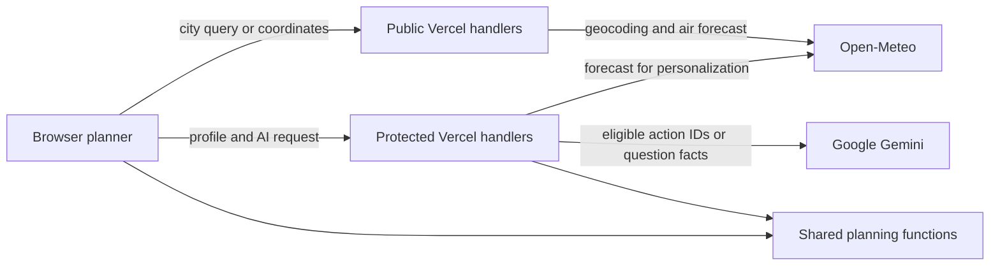

# AirWise · Urban Air Quality Assistant

AirWise helps a family answer three practical questions on a smoggy day. When is the forecast most favorable for an outdoor errand? Which changes make sense in this household? How much solo driving could a different commute replace? Each plan combines a city-level air forecast, household-specific actions with sources, and an interactive travel calculation. Built for Hack2Skill Challenge 6.

[Open AirWise on Vercel](https://airwise-pearl.vercel.app) · [Watch the project demo](https://youtu.be/YDEvrKXkfA8) · [See verification results](docs/VERIFICATION.md)

## Try a plan in one minute

1. Select **Try winter-smog demo**. The fictional forecast works once the page has loaded. Inspect the source and impact explanation on an action card.
2. Open **Explore your plan**. Keep the demo commute of 8 km each way on five days. Switch two days to shared travel. The weekly baseline is **80 km**, with **32 km of solo driving replaced** and **48 km remaining**.
3. Choose a two-hour outdoor activity and narrow the available hours. Compare the suggested block with the hourly table. Download the plan to keep the selected scenario and its UTC timestamps.
4. For your own city, select **Check air & build a plan**. City search, forecasts and local planning are public. Reviewers with an app access token can also select **Personalize with Gemini**, or ask **“How many kilometres does my current selection replace?”** under **Ask about my plan**.

## Architecture and data flow

AirWise serves static HTML, CSS and a bundled JavaScript client from Vercel. The browser and server import shared planning functions, so the simulator, downloaded plan and question-answering endpoint use the same arithmetic and window-selection rules.



| Decision | How the implementation makes it |
| --- | --- |
| Which actions apply? | A deterministic catalogue filters by air conditions, household sensitivity, cooking fuel, access to a cleaner, budget and travel mode. Each eligible action carries its explanation and source. [Action catalogue](lib/actions.js) |
| Which outdoor window should I choose? | For every complete one- or two-hour block within the selected range, the planner finds the highest hourly US AQI. It then chooses the block with the **lowest peak**, breaking ties in favor of the earliest start. This minimax rule prevents a relatively clean hour from averaging away a more polluted one. Missing hours break a block. Elapsed starts drop out of live plans. [Forecast logic](lib/forecast.js) |
| What does changing my commute achieve? | For solo-car travel, weekly distance is one-way distance × 2 × commute days. Switching days replaces the corresponding round trips. The result measures potential solo-car kilometres displaced. Estimating emissions or personal exposure would also require vehicle, occupancy and route data. [Scenario calculations](lib/scenario.js) |
| What happens during simultaneous lookups? | The public forecast handler shares an in-flight promise for matching coordinates on one server instance. It tracks up to 32 distinct lookups and removes each entry on completion or failure. In a test burst, 20 overlapping requests at the same coordinates received 20 successful responses from one upstream call. [Handler](api/air.js) · [Concurrency tests](tests/forecast-requests.test.js) |

### Where Gemini contributes

**Personalization** starts with a validated household profile and a modelled forecast. Gemini receives eligible action IDs and titles along with selected household context and an optional goal. It proposes an ordering. The server checks the IDs, preserves mandatory precautions at the top and retains eligible actions the model omitted. The application supplies the final action text, calculations and source links. [Personalization handler](api/analyze.js) · [Gemini adapter](lib/server/gemini.js)

**Questions about a plan** take a different path. The server rebuilds a set of answerable facts from the submitted profile, forecast and current scenario. Gemini selects a fact ID for the question. The server resolves that ID to an answer, including the calculated value or forecast time where relevant. A question outside the available evidence gets an insufficient-evidence response. Changing the scenario clears the previous answer. [Question handler](api/question.js) · [Question contract](lib/question-contract.js)

## Run locally

Use **Node.js 24.x** and npm. From the repository root, run the following commands.

```sh
npm ci
npm run dev
```

Open [the local planner](http://127.0.0.1:5173). The dev server builds the browser bundle on startup and serves the API handlers. Restart it after changing client code. The fictional demo needs no provider credentials. Public city search and live forecasts require network access to Open-Meteo.

For Gemini, create an ignored `.env.local` using [.env.example](.env.example). Set `GEMINI_API_KEY` for the server and `APP_ACCESS_TOKEN` for authorized app users. Optionally set `GEMINI_MODEL` to override the default. Restart the server, then enter only the **app access token** under **AI personalization access**. Vercel production uses the same environment variable names. [Deployment and live API verification](docs/ACCESS.md)

### HTTP API

| Method and route | Access | Request and result |
| --- | --- | --- |
| `POST /api/locations` | Public | A city `query` returns matching locations and coordinates. |
| `POST /api/air` | Public | Numeric `latitude` and `longitude` return current modelled conditions and up to 24 hourly entries. An unusable upstream forecast produces HTTP 502. |
| `POST /api/analyze` | Bearer token | A household profile returns a personalized plan grounded in current modelled air and eligible actions. |
| `POST /api/question` | Bearer token | A profile, snapshot, question and optional scenario selection return an `answer` and its `kind`. |
| `GET /api/models` | Bearer token | Returns model diagnostics for checking the Gemini configuration. |

For example, request a forecast directly from the running local server in PowerShell.

```powershell
Invoke-RestMethod -Method Post -Uri 'http://127.0.0.1:5173/api/air' -ContentType 'application/json' -Body '{"latitude":28.61,"longitude":77.21}'
```

## Engineering and verification

Zod schemas validate data at request boundaries. Strict TypeScript checking covers JavaScript via JSDoc. The client cancels superseded requests and ignores late replies so a response for an earlier selection cannot overwrite the current plan. GitHub Actions runs repository checks, dependency auditing and fixture-backed desktop and phone-width browser workflows. [Contracts](lib/contracts.js) · [Request lifecycle](lib/client/latest-request.js) · [CI workflow](.github/workflows/verify.yml)

| Command | What it verifies |
| --- | --- |
| `npm run verify` | Formatting, ESLint with zero warnings allowed, strict type checking, Node tests with coverage thresholds, and the production build. |
| `npm run test:coverage` | Unit, API and simulated-DOM tests with a 98% minimum for each of line, branch and function coverage across the configured modules. |
| `npm run test:browser` | Playwright journeys across desktop and narrow viewports, including accessibility checks. Install Chromium once with `npx playwright install chromium`. |

At application revision [7ec854a](https://github.com/kavsrd13/clausecompass/commit/7ec854a), all **105 Node tests passed**. Instrumented modules reached **100% line**, **98.13% branch** and **100% function** coverage. The production JavaScript bundle was **16,018 bytes gzipped**. The verification record identifies the tested revision and distinguishes browser results from Node measurements. [Verification record](docs/VERIFICATION.md) · [Code quality and design decisions](docs/CODE_QUALITY.md)

## Data sources, privacy and limits

- **Forecast interpretation.** Open-Meteo supplies CAMS modelled outdoor conditions. The hourly table uses US AQI and PM2.5. Conditions can vary within a model grid cell. A lowest-peak window can still have poor air throughout. Use local official advisories when making activity decisions. [Open-Meteo Air Quality API](https://open-meteo.com/en/docs/air-quality-api) · [CAMS](https://atmosphere.copernicus.eu/) · [US AQI scale](https://www.airnow.gov/aqi/aqi-basics/)
- **Indoor guidance.** Recommendations address particle sources, filtration and ventilation. AirWise has no indoor sensor reading for a household. The action cards link to guidance that explains their rationale. [WHO exposure guidance](https://www.who.int/news-room/questions-and-answers/item/air-pollution-personal-interventions-and-risk-communication) · [EPA air cleaners](https://www.epa.gov/indoor-air-quality-iaq/guide-air-cleaners-home) · [EPA indoor particles](https://www.epa.gov/indoor-air-quality-iaq/indoor-particulate-matter) · [EPA ventilation](https://www.epa.gov/indoor-air-quality-iaq/improving-indoor-air-quality)
- **Household data.** The app keeps household inputs in page memory and offers an explicit Markdown download. City lookup sends search text to Open-Meteo, and the public forecast sends coordinates. Gemini personalization sends selected preferences, city and optional goal to Google. Plan questions send question text and candidate facts to Google. Leave identifying or medical details out of free text. Provider retention terms apply.
- **Deployment scope.** The Gemini key stays on the server. Protected endpoints use a shared bearer token. Distributed usage quotas and manual screen-reader evaluation remain open. [Access guide](docs/ACCESS.md) · [Verification scope](docs/VERIFICATION.md)
